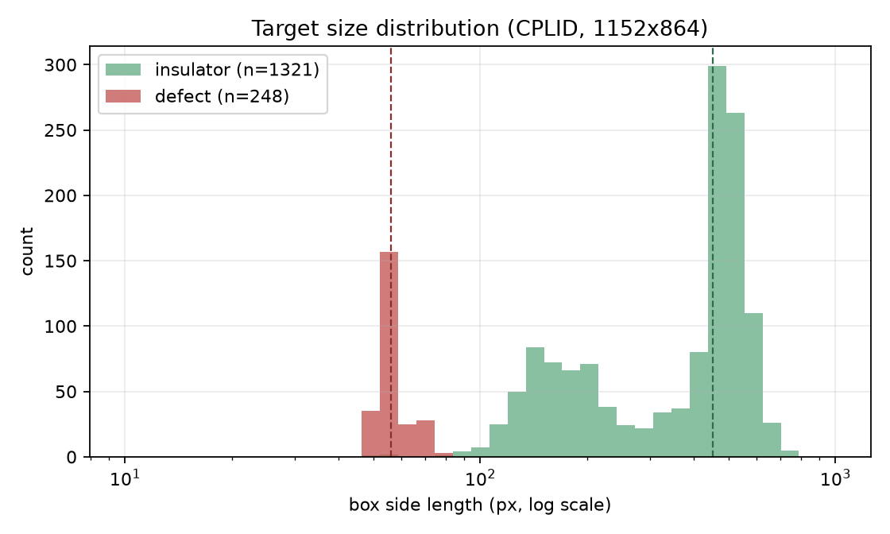
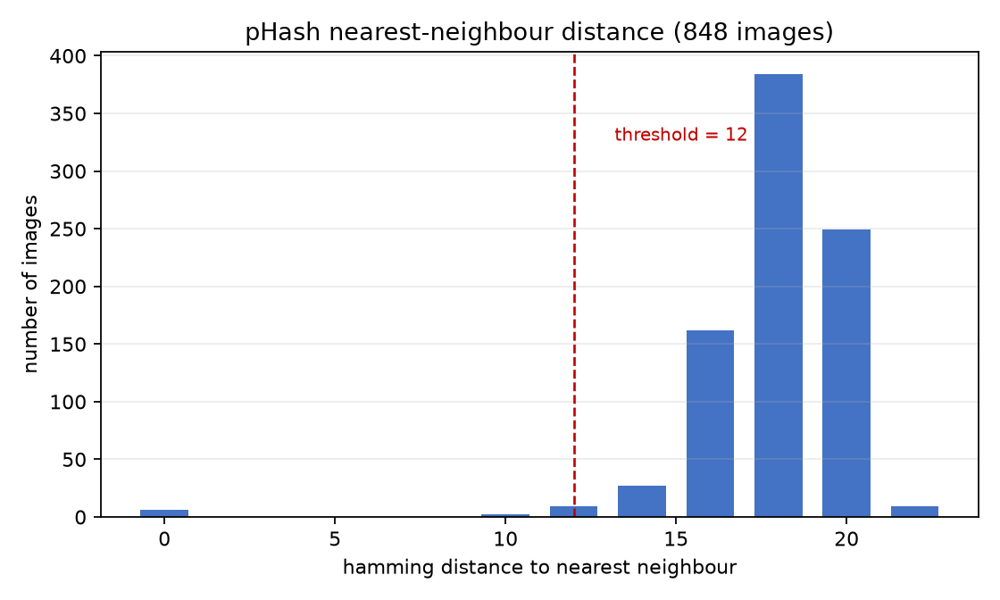
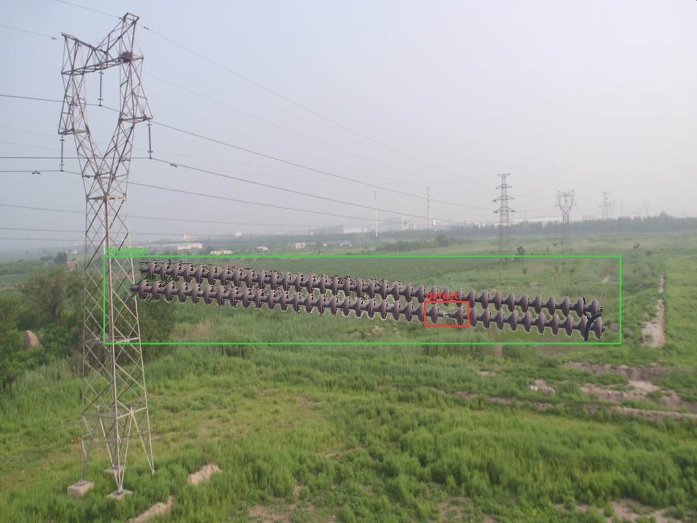

# 第 2 章 数据集与预处理（报告初稿）

> 撰写：宁湘涵 · 2026-11-20 · 对应计划书 T15「报告数据章」
> 本章数字均来自 `reports/数据卡片.md` 与 `reports/泄漏核查.md`，图号对应 `figs/INDEX.md`。

## 2.1 数据集选择

本项目采用公开数据集 **CPLID**（Chinese Power Line Insulator Dataset，`github.com/InsulatorData/InsulatorDataSet`），
由无人机航拍采集，共 848 张 RGB 图像，分辨率统一为 1152×864。选择理由有三：

1. **场景一致**：全部为输电线路现场航拍，与"无人机巡检"的应用场景直接对应；
2. **标注规范**：Pascal VOC XML 标注，含 `insulator`（整串绝缘子）与 `defect`（缺陷区域）两类框；
3. **规模适中**：848 张在本项目仅有 CPU 的条件下可在数十分钟内完成一轮训练。

需要说明的是，该数据集的 **248 张缺陷图像为人工合成**（将破损部件贴入正常图像），并非真实故障实拍。
因此本项目定位为"**方法验证与流程打通**"，其对真实缺陷的泛化能力需在自有标注数据上进一步验证，
这一局限在 6.3 节展开。

## 2.2 数据规模与标注统计

| 项 | 数值 |
|---|---|
| 图像总数 | 848（正常 600 / 缺陷 248） |
| 分辨率 | 全部 1152×864 |
| `insulator` 框 | 1321 |
| `defect` 框 | 248 |
| 每图框数 | 1 框 247 张、2 框 502 张、3 框 81 张、4 框 15 张、5 框 3 张 |

两个类别在**图像层面**的比例是 600:248 ≈ 2.4:1，但在**框层面**是 1321:248 ≈ **5.3:1**，
再叠加每张图上千个背景锚点，正负样本比例实际相差一个数量级以上。这是后续引入过采样与
Focal Loss 的直接依据（第 3、4 章）。

## 2.3 目标尺寸分析

对全部标注框的像素尺寸统计（图 fig01）显示两类目标存在**数量级差异**：

| 类别 | 中位面积 | 等效边长 | 占全图面积 |
|---|---|---|---|
| `insulator` | 97,383 px² | ≈ 312 px | 9.78% |
| `defect` | 3,036 px² | ≈ 55 px | **0.31%** |

缺陷目标的边长仅为图像宽度的 **4.8%**。当输入分辨率缩放到 320×320 时，缺陷的等效边长只剩约
**15 px**，接近甚至低于 YOLOv8 P3 检测头（stride 8）的有效感受野下限。这一观察在第 4 章的
对照实验中被证实为缺陷类漏检的主要来源，也是消融实验必须包含 640 分辨率组（C 组）的原因。

*图 fig01　CPLID 目标尺寸分布（横轴为对数尺度的框边长，竖虚线为中位数）*

## 2.4 数据划分与同源泄漏核查

采用**按类别分层**的随机划分，`val_ratio = 0.2`、`seed = 42`：

| 划分 | 图像 | 正常 | 缺陷 | `insulator` 框 | `defect` 框 |
|---|---|---|---|---|---|
| 训练集 | 678 | 480 | 198 | 1052 | 198 |
| 验证集 | 170 | 120 | 50 | 269 | 50 |

CPLID 不含杆塔/线路元信息，无法按杆塔分组划分，因此存在"同源图像跨划分"的风险——
同一基杆塔的多张照片若同时进入训练集与验证集，会使指标偏乐观。为量化该风险，本文采用
**感知哈希（pHash）+ 像素级复核**的两级核查（详见 `reports/泄漏核查.md`）：

1. 对 848 张图计算 64 位 pHash，两两比较汉明距离，阈值取 8 / 10 / 12；
2. 对候选图对再做缩放后逐像素平均绝对差（MAD）复核，区分"同一张图 / 同底图 / 不同图"。

结果（图 fig07）：阈值 12 时共有 9 对候选，其中 3 对为**训练集内部的完全重复图**（MAD = 0.00），
3 对跨划分候选的 MAD 在 11–33 之间，均为**同场景不同拍摄**，判定为不同图。
即：**当前划分不存在实质性的跨划分同源泄漏**（验证集泄漏图像 0 张）。

*图 fig07　848 张图的最近邻汉明距离分布，虚线为判定阈值 12*

据此，本文保留随机分层划分，不改为分组划分——因为改划分会导致全部实验需重跑，
而在无泄漏的前提下其收益不足以抵消成本。训练集内部 3 对重复图在正式训练前已剔除。

## 2.5 预处理流程

预处理包含三步，均由 `insulator_yolo/prepare_dataset.py` 完成（`--check 8` 会额外输出 8 张标注自检图）：

1. **格式转换**：VOC XML → YOLO txt（归一化中心点 + 宽高），类别映射 `insulator→0`、`defect→1`；
2. **分层划分**：按"正常/缺陷"分层抽样，固定 `seed=42`，保证验证集缺陷占比与全集一致；
3. **一致性校验**：解析每张图的尺寸与框坐标，剔除越界/非法标注，输出 `stats.json` 统计文件。

*图 fig08　标注自检示例：绿框为整串绝缘子，红框为缺陷区域（可见合成补丁的边界）*

## 2.6 本章小结

1. 采用 CPLID 848 张图像，二分类检测任务（insulator / defect），按 8:2 分层划分为 678/170；
2. 缺陷目标边长中位 55 px，属典型小目标，320 输入下仅约 15 px——这是后续实验的核心约束；
3. 框层面类别不均衡达 5.3:1，需要过采样与损失层加权；
4. pHash + 像素级复核表明当前划分无跨划分同源泄漏，指标不存在"见过验证集"的虚高；
5. 缺陷样本为合成数据，是本项目结论外推的主要限制。